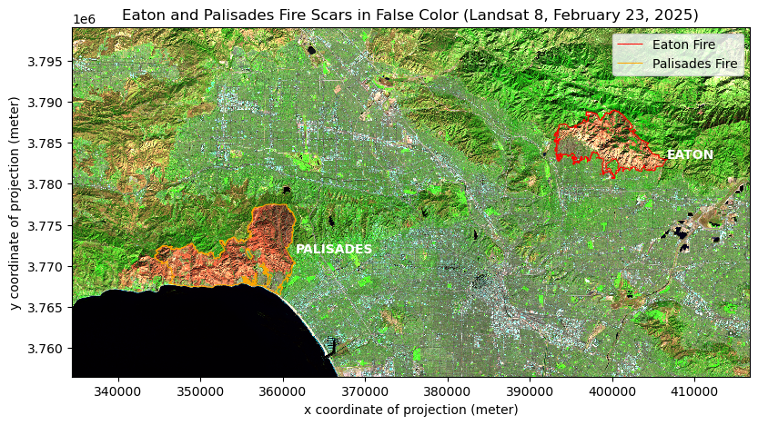

# Visualizing Palisades and Eaton Fire Scars Through True and False Color Imagery


<p align="center">
  
  <br>
  <a href="https://www.foxweather.com/extreme-weather/los-angeles-fire-department-palisades-eaton-california-wildfires">Image source: FOX Weather</a>
</p>


## The Purpose of this Repository
This repository explores how satellite imagery can be used to visualize the impacts of the January 2025 Eaton and Palisades Fires in Los Angeles County. Using Landsat 8 surface reflectance data and fire perimeter data, it creates true color and false color images and maps the burn scars alongside the official fire boundaries.


## Repository Structure 
```
eds220-hwk4
│--  images                                   # Images for the README and results sections
│--  .gitignore                               # Files excluded from version control (e.g., data)
│--  hwk4-task2-false-color-MATHEWS.ipynb     # Notebook with analysis and visualizations
│--  README.md                                # Overview of the repository
```


## Highlights of the Analysis
- Exploring and wrangling raster data stored in a .nc file using `xarray` and `rioxarray` 
- Restoring missing information in a geospatial dataset
- Reprojecting vector data to match the raster's CRS 
- Handling outliers and missing values that restrict plotting
- Creating true color and false color images
- Combining raster and vector data to map fire scars and explain how false color imagery highlights burned areas more effectively


## Results




## Data
This analysis uses two datasets. The first is fire perimeter data for the Eaton and Palisades Fires housed in the Los Angeles County Enterprise ArcGIS hub, but pulled from CAL FIRE’s Historical Fire Perimeter Dataset. The data was downloaded as two individual shapefiles (one per fire). The second is a simplified collection of Landsat 8 Collection 2 Level-2 atmospherically corrected surface reflectance bands (red, green, blue, near-infrared, and shortwave infrared) collected on February 23, 2025. This data was retrieved from the Microsoft Planetary Computer, clipped to the area surrounding the fire perimeters, and provided through the EDS 220 course shared Google Drive. It is intended for visualization and educational purposes only.

Neither dataset is included in this repository. The fire perimeter data can be downloaded from the link in the References section, and the Landsat data is available through the EDS 220 course shared Google Drive.


## References

Los Angeles County. (2025). Palisades and Eaton dissolved fire perimeters (2025) [GIS dataset]. *Los Angeles County Enterprise GIS.* https://egis-lacounty.hub.arcgis.com/datasets/lacounty::palisades-and-eaton-dissolved-fire-perimeters-2025

Microsoft. (n.d.). Landsat Collection 2 Level-2. *Microsoft Planetary Computer.* https://planetarycomputer.microsoft.com/dataset/landsat-c2-l2

Galaz García, C. (2025). EDS 220: Working with Environmental Datasets [Course website]. Master of Environmental Data Science, Bren School of Environmental Science & Management, University of California, Santa Barbara. https://meds-eds-220.github.io/MEDS-eds-220-course/